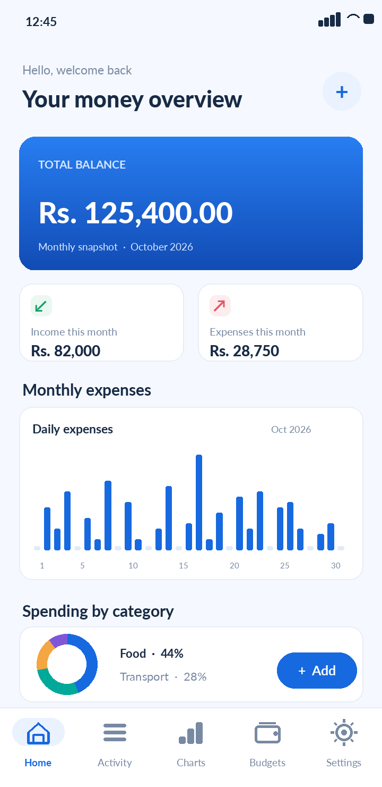
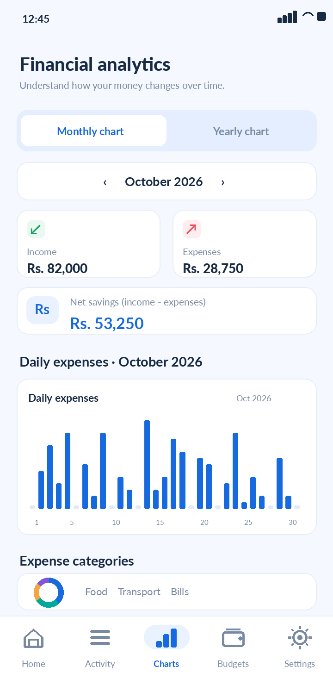
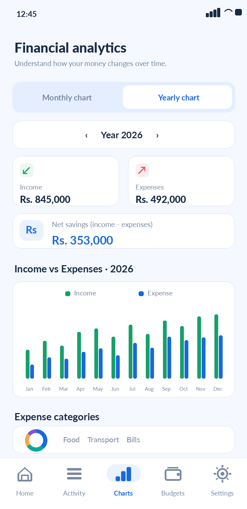
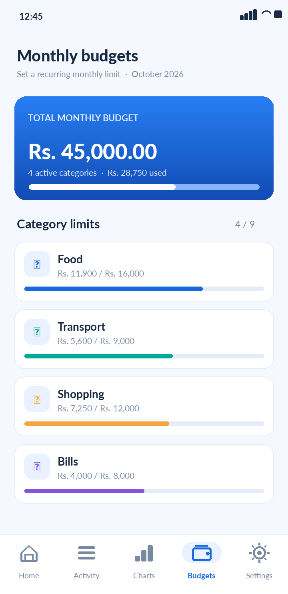
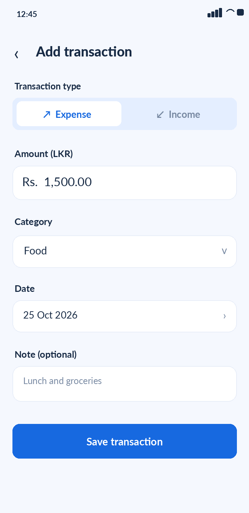

<div align="center">


# Smart Money Manager

**An offline-first personal finance tracker built with Flutter and SQLite.**

Track income and expenses, organize monthly budgets, and explore spending trends with a modern blue-themed Android experience.


</div>

## App preview

> **Design previews only — not screenshots captured from an Android device.** These illustrations were created from the project's Flutter screen structure and blue theme using **fictional sample amounts**. The live app may vary. Replace them with device screenshots after release testing.

<table>
<tr>
<td align="center"><br/><b>Dashboard</b></td>
<td align="center"><br/><b>Monthly chart</b></td>
<td align="center"><br/><b>Yearly chart</b></td>
</tr>
<tr>
<td align="center"><br/><b>Budgets</b></td>
<td align="center"><br/><b>Add transaction</b></td>
<td align="center"><b>Blue-themed UI</b><br/>Android · Material 3<br/>LKR currency<br/>Offline by design</td>
</tr>
</table>

## Features

| Area | Capabilities |
| --- | --- |
| **Dashboard** | Balance overview, monthly income and expenses, recent transactions, and category summary |
| **Transactions** | Add, edit, delete, search and filter income/expense records; attach category, date and optional note |
| **Monthly analytics** | Daily spending bar chart, income/expense summary, expense category breakdown and net savings |
| **Yearly analytics** | Income-vs-expense comparison across all 12 months of a selected year |
| **Budgets** | Per-category monthly limits, usage progress and overspending indicators |
| **Savings goals** | Monthly savings target and progress based on net income minus expenses |
| **Offline operation** | On-device SQLite database; no login or external backend required |
| **Currency** | Sri Lankan Rupees (LKR / Rs.) |

## Tech stack

| Layer | Technology |
| --- | --- |
| Mobile UI | Flutter + Dart + Material 3 |
| State management | Provider |
| Database | SQLite using `sqflite` |
| Charts | Custom Flutter chart widgets |
| Platform | Android |
| Version control | Git + GitHub |

**Application flow:** `Flutter screens → MoneyController (Provider) → MoneyDatabase (SQLite)`

## Getting started

### Requirements

- Flutter SDK and a configured Android toolchain
- VS Code or Android Studio
- An Android phone with USB debugging enabled, or an Android emulator

### Run locally

```bash
git clone https://github.com/nilakshasandaru/smart-money-manager.git
cd smart-money-manager
flutter pub get
flutter devices
flutter run
```

### Create a release APK

```bash
flutter build apk --release
```

Output path: `build/app/outputs/flutter-apk/app-release.apk`

> APK builds and Android device behavior should be tested locally before the application is treated as a production release.

## Project structure

```text
smart-money-manager/
├── android/                  # Android platform project
├── lib/
│   ├── data/                 # SQLite persistence
│   ├── models/               # Transactions and budget models
│   ├── screens/              # Dashboard, history, analytics, budgets, settings
│   ├── state/                # MoneyController / Provider state
│   ├── utils/                # Financial calculations and formatting
│   ├── widgets/              # Reusable finance cards and chart widgets
│   └── main.dart             # Application entry point
├── assets/
│   └── previews/             # Illustrative README images (not runtime assets)
├── test/                     # Flutter tests
├── pubspec.yaml
└── README.md
```

## Privacy and data storage

- Transactions, budgets and preferences are saved **locally on the device**.
- Core features do not require an account, internet connection or cloud database.
- **No automatic backup or cross-device synchronization** is included in this version.
- Clearing application storage or uninstalling the app may erase saved financial records.
- Previews above contain fictional amounts; **no real financial records are included**.

## Development status

**In development.** Source code is available; final device testing and release verification remain to be completed. The repository includes an **Add sample data** option under Settings to explore analytics without entering real financial information.

### Possible future improvements

- Export transactions to CSV or PDF
- Backup and restore
- Optional cloud synchronization
- Recurring transactions and reminders
- Biometric app lock

## Developer

GitHub: **[@nilakshasandaru](https://github.com/nilakshasandaru)**  
Repository: **[smart-money-manager](https://github.com/nilakshasandaru/smart-money-manager)**

---

<div align="center"><sub>Built with Flutter · Designed for everyday money management</sub></div>
